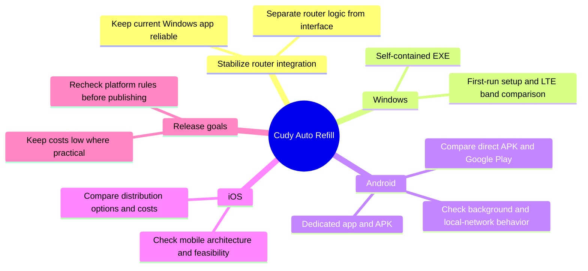

# Product roadmap

This document captures longer-term ideas. It is a planning note, not a delivery promise or release schedule. Keep distribution and store costs low where practical, and verify current platform rules before choosing a release channel.

## Mind map

## Direction

- Keep the current working Windows application reliable while the router integration evolves.
- Separate router communication and refill logic from the desktop interface before building additional clients.
- Preserve safe credential storage, clear diagnostics, and explicit user control on every platform.

## Windows

- Package the mature desktop application as a self-contained `.exe`.
- Include a first-run setup flow and the option to compare LTE bands.
- Decide later whether code signing or a particular distribution channel is worth its cost.

## Android

- Explore a dedicated Android app and an installable `.apk`.
- Check whether the router-control logic can be shared and design around Android background-network and local-network permissions.
- Compare direct APK distribution with Google Play, including the developer-verification rules in force when publishing.

## iOS

- Explore an iPhone app after the shared logic and mobile architecture are clearer.
- Confirm technical feasibility and the current Apple distribution requirements and fees before committing to a release route.

## Release planning

- Treat Windows, Android, and iOS as separate release targets with their own testing and setup requirements.
- Recheck store fees, account requirements, signing, and direct-install rules immediately before distribution; these can change.
- Choose a visual roadmap or task tracker only if it helps; this file remains the versioned overview in the repository.
